# 🏦 M&A Investment Banking — DealLab Brazil

### Python 3.10 · Financial Modelling · DCF/WACC · Quality of Earnings · Deal Structuring · Streamlit · Excel · PowerPoint

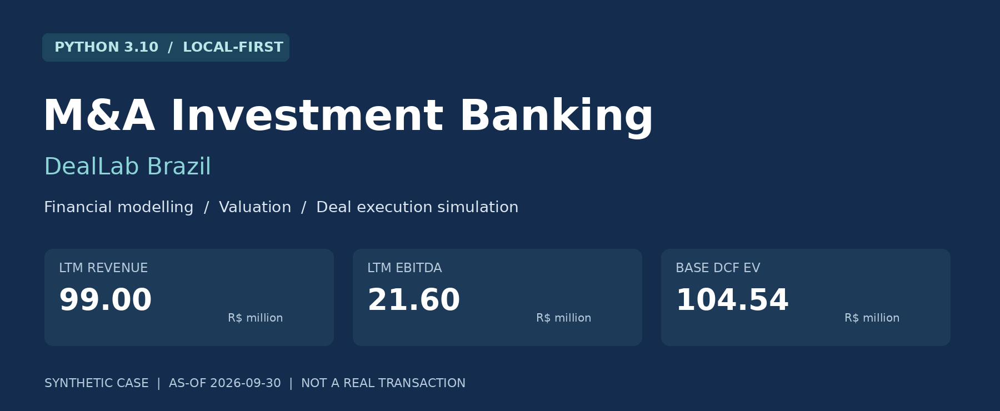

[](https://github.com/Yuri-Fernando/M-A-Investment-Banking/actions/workflows/ci.yml)


Uma bancada analítica para conectar **demonstrações financeiras, projeções, valuation, diligência, preço e materiais de decisão** em um fluxo reproduzível de M&A. O mesmo motor Python alimenta o CLI, o dashboard, os modelos de Excel e os relatórios: os números não são recalculados de forma independente em cada interface.

> **Natureza do projeto:** demonstração de pesquisa e engenharia com empresa, compradores, propostas e documentos fictícios. O caso **Project Aurora / NexaOps Analytics Ltda.** não representa uma transação real, assessoria prestada, auditoria contábil ou recomendação de investimento. Fontes públicas só podem entrar como dados separados, datados e verificáveis.

## Status

🟢 **MVP local funcional, com o fluxo sintético de ponta a ponta implementado e validado.** Dados reais de mercado e uso em produção possuem limites próprios, descritos adiante.

| Área | Estado atual | Evidência |
|---|---|---|
| Ingestão e controles de dados | Implementados | Sete CSVs, SHA256, escala, escopo, períodos e publicação |
| Histórico financeiro e LTM | Validados | DRE, BP, DFC, dívida, PPE e patrimônio conciliados |
| Forecast integrado | Implementado | Q4/2026 separado e FY2027–FY2031 em três cenários |
| DCF e WACC | Implementados | FCFF nominal BRL, stub, terminal normalizado e sensibilidades |
| QoE e preço de aquisição | Implementados | Aceite por evidência, EV/equity, NWC, earn-out, escrow e rollover |
| Workflow de M&A | Simulação funcional | Etapas, revisão, evidência, shortlist e bloqueios de closing |
| Dashboard | Funcional | Onze áreas, cenários e premissas editáveis |
| Excel | Gerado e verificado | Três arquivos, 33 abas cada, 518 fórmulas por cenário |
| Relatórios e apresentações | Gerados | IC, DD, valuation, closing, teaser, CIM e management deck |
| Validação local | Aprovada | 69 testes; Ruff; Excel e PowerPoint nativos |
| Comparáveis públicos | Importação disponível; dados não carregados | Sem preços, EBITDA ou múltiplos inventados |
| CI | Configurada para Linux e Windows | Resultado corrente no badge e na aba Actions |
| Docker | Configuração disponível | Runtime Docker não apresentado como validado |
| Operação real | Fora da demonstração | Exige dados, segurança, controles e revisão profissional próprios |

Os arquivos de evidência são pequenos e selecionados: [resumo de validação](docs/evidence/validation.json), [auditoria nativa de Office](docs/evidence/native_office_audit.json) e [referência financeira reproduzível](docs/evidence/model_reference.json). As capturas desta página são da aplicação e dos arquivos reais gerados pelo projeto.

---

## Descrição / Contexto

Uma análise de aquisição raramente falha apenas por faltar um cálculo de DCF. Os problemas costumam aparecer na passagem entre as etapas: um período de nove meses tratado como ano completo, EBITDA ajustado sem aprovação, dívida contada duas vezes, um peg de capital de giro sem histórico mensal ou um relatório cujo número já não corresponde ao Excel.

O DealLab trata essas passagens como contratos verificáveis:

1. a informação entra com origem, unidade, período e classificação;
2. as demonstrações precisam fechar antes de alimentar projeções;
3. premissas e resultados ficam congelados por execução;
4. valor operacional e preço das ações permanecem separados;
5. riscos e condições não desaparecem porque o valuation ficou positivo;
6. relatórios, planilhas e dashboard consultam o mesmo resultado;
7. qualquer arquivo publicado localmente pode ser conferido por checksum.

O objetivo é tornar o raciocínio financeiro **defensável, rastreável e executável**, incluindo os resultados desfavoráveis e as informações ausentes.

## 🌱 Como nasceu

O ponto de partida foi uma pergunta técnica: **como transformar um caso de M&A em um sistema reproduzível, sem reduzir o projeto a uma planilha isolada ou a um dashboard com números estáticos?**

A implementação evoluiu a partir de um conjunto de demonstrações sintéticas conciliáveis. Primeiro vieram os controles contábeis; depois, o business plan, o DCF, os mecanismos de preço e os materiais. A apresentação foi construída sobre esse núcleo.

```text
Caso financeiro sintético
        ↓
Contratos de dados e conciliação
        ↓
LTM / QoE / business plan de três demonstrações
        ↓
Valuation / cenários / estrutura da transação
        ↓
Pacote de decisão com fontes e checksums
        ↓
Dashboard / Excel / PDF / PowerPoint / SQLite
```

A decisão de usar uma empresa fictícia permite demonstrar o fluxo inteiro sem expor informações de clientes e sem atribuir dados privados a uma companhia real.

## 🎯 Objetivos

- Reconciliar demonstrações financeiras antes de utilizá-las em decisões.
- Distinguir receita, EBITDA, lucro líquido, caixa operacional e FCFF.
- Construir LTM corretamente, preservando a distinção entre fluxos e saldos.
- Controlar ajustes de earnings por período, evidência e revisor.
- Projetar DRE, balanço e caixa sem plugs artificiais.
- Modelar WACC e DCF com moeda, impostos e datas coerentes.
- Mostrar a sensibilidade do valor a crescimento, margens, reinvestimento e desconto.
- Explicar a passagem de EV para equity e caixa recebido pelo vendedor.
- Separar sinergia do comprador do valor standalone.
- Simular a execução do processo com gates e trilha de decisões.
- Gerar materiais editáveis e arquivos verificáveis a partir de uma única execução.
- Manter dados faltantes e riscos pendentes visíveis.

## 🔬 Linha de pesquisa e desenvolvimento

O projeto reúne quatro frentes complementares:

| Frente | Pergunta investigada | Implementação |
|---|---|---|
| Integridade financeira | Os números conciliam antes do valuation? | Identidades contábeis, validação de períodos, sinais e escala |
| Engenharia de valuation | Quanto o valor depende das premissas? | Três cenários, DCF datado, terminal normalizado e stress |
| Economia da transação | O que o vendedor recebe e em quais condições? | EV/equity, true-up, earn-out, escrow, participação e rollover |
| Reprodutibilidade | É possível explicar e reconstruir um número do relatório? | Snapshots, registro de métricas, fórmulas, hashes e testes |

A busca local de evidências e o Monte Carlo são recursos auxiliares. O projeto não depende de um LLM para calcular, aprovar ajustes ou formular uma resposta financeira.

---

## 🖼️ Visão da solução

### Dashboard executivo

Indicadores LTM, valor standalone, cenários, proposta ilustrativa e condições pendentes na mesma interface.

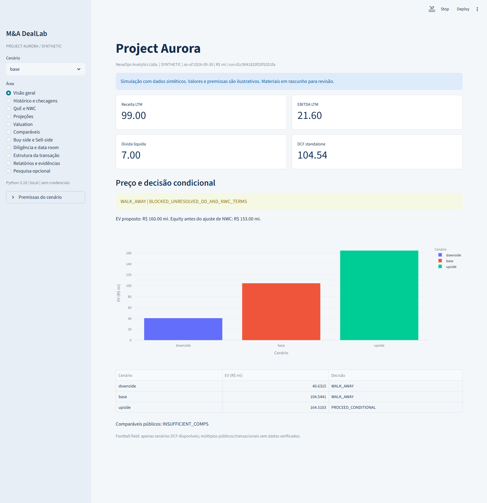

### Valuation e sensibilidades

O cenário selecionado altera as projeções e a avaliação. A matriz WACC × crescimento terminal e os stresses operacionais usam o mesmo motor financeiro.

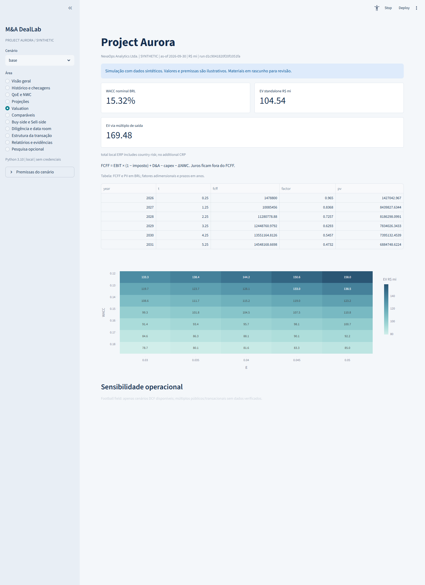

### Estrutura da transação

A ponte de preço mantém EV, dívida, caixa, equity e composição da contraprestação separados.

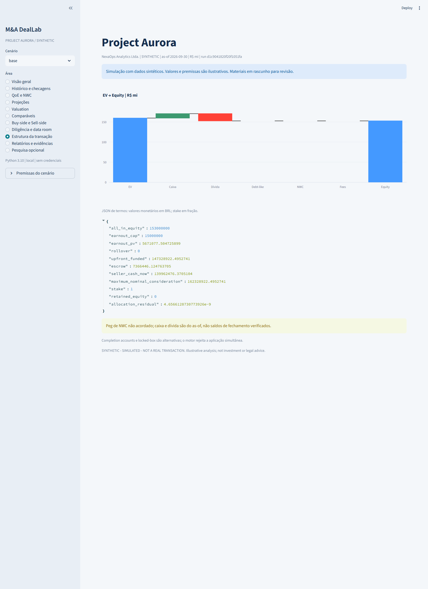

### Excel e materiais editáveis

| DCF no Excel gerado | Checagens contábeis no Excel |
|---|---|
| 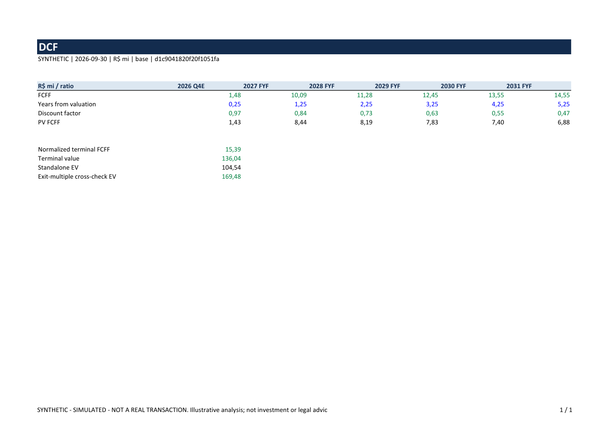 | 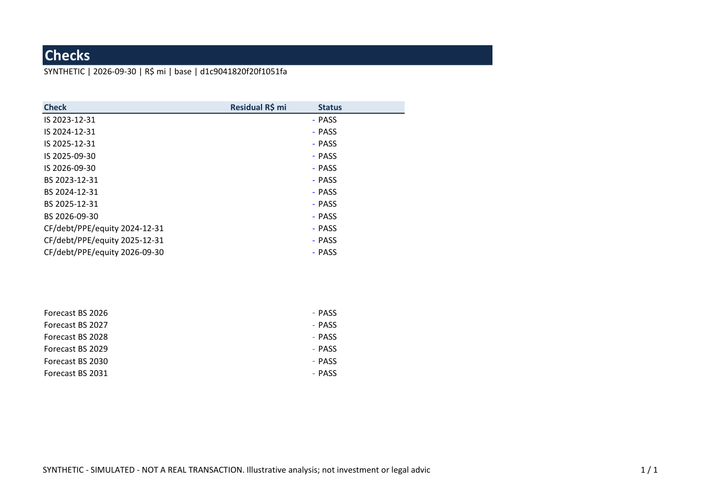 |

| CIM: valuation do caso | Management presentation |
|---|---|
| 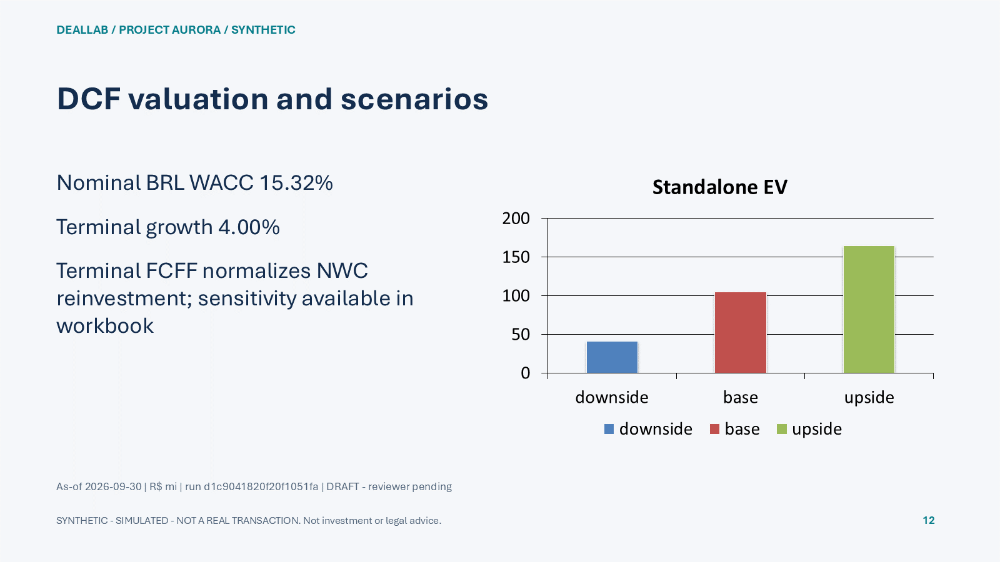 | 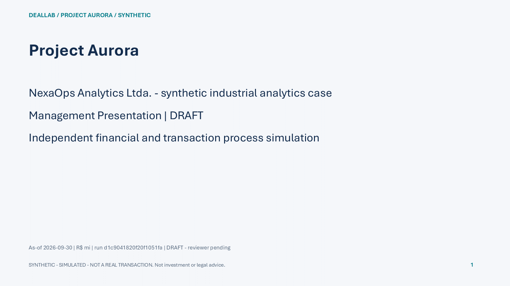 |

As prévias do Office foram produzidas por abertura e renderização nativa dos arquivos, sem recriar uma interface fictícia.

---

## 🏗️ Arquitetura

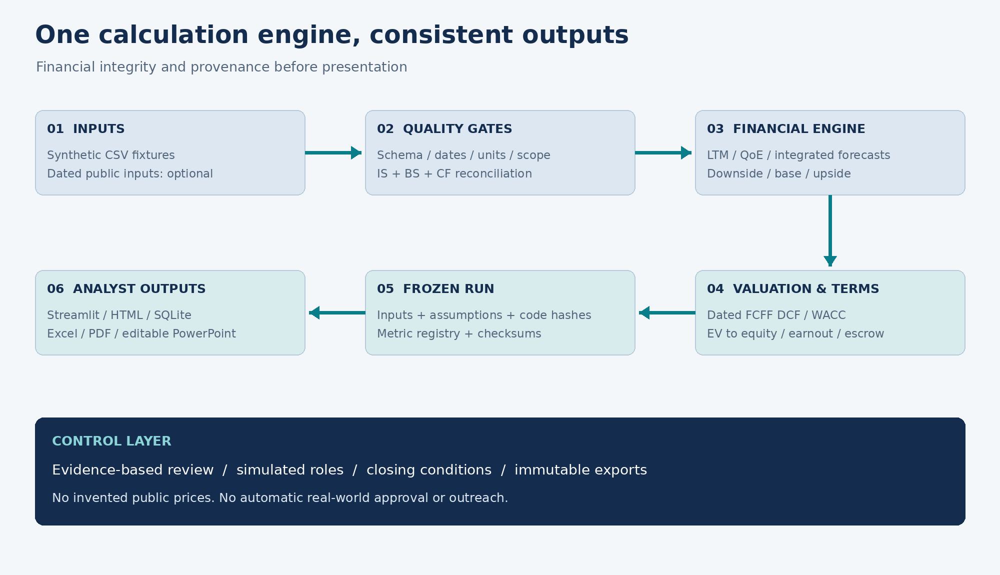

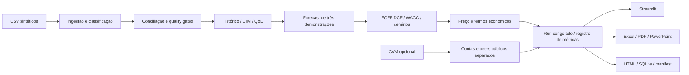

### Princípios de projeto

- **Finance-first:** conciliação e tratamento de dados precedem o valuation.
- **Uma fonte de cálculo:** a interface não contém uma segunda implementação de DCF.
- **Execução local:** o fluxo sintético funciona sem rede, credenciais ou API paga.
- **Ausência explícita:** dado faltante não vira zero, preço estimado ou múltiplo inventado.
- **Períodos coerentes:** FY, 9M, trimestre e saldo em uma data não são intercambiáveis.
- **Proveniência:** entradas e código participam do identificador da execução.
- **Exportação congelada:** mudar premissas gera outro run; não reescreve relatórios anteriores.
- **Revisão separada:** produzir um rascunho não significa aprovar sua distribuição.
- **Limites operacionais:** papéis e closing são simulações, sem identidade ou aprovação real.

### Módulos

| Módulo | Responsabilidade |
|---|---|
| `contracts.py` | Premissas imutáveis, classificações, moeda, data-base e erros |
| `ingestion.py` | Leitura dos CSVs, escalas, hashes, histórico, LTM, NWC e QoE |
| `finance.py` | Forecast integrado, FCFF, DCF, sinergias e sensibilidades |
| `transaction.py` | EV/equity, contraprestação, scoring e máquinas de estados |
| `public_data.py` | Snapshot CVM, parse explícito e contrato de trading comps |
| `services.py` | Orquestração, cenários, run ID e registro de métricas |
| `workbook.py` | Modelo Excel com 33 abas e fórmulas |
| `verification.py` | Avaliação independente das fórmulas e conferência de caches |
| `reporting.py` | Relatórios PDF/Markdown e teaser anônimo |
| `presentations.py` | CIM e management deck com gráficos editáveis |
| `materials.py` | LOI econômica, checklist SPA e comparação de ofertas fictícias |
| `export.py` | Publicação local transacional, SQLite, HTML e checksums |
| `research.py` | Busca de evidências e Monte Carlo ilustrativo |
| `cli.py` | Comandos de validação, modelagem, exportação e dados públicos |
| `ui/app.py` | Dashboard sobre o serviço compartilhado |

Detalhamento: [arquitetura e contratos](docs/ARCHITECTURE.md).

---

## ⚙️ Funcionamento de ponta a ponta

### 1. Carregar e qualificar as entradas

O loader lê as sete fixtures originais, calcula SHA256 e converte os valores de **R$ milhões para BRL**. Campos mandatórios ausentes, duplicações de conta/período, moeda/escala incompatível, entidade errada ou informação publicada depois do cutoff impedem o cálculo.

As classificações previstas são `SYNTHETIC`, `PUBLIC_OFFICIAL`, `PUBLIC_THIRD_PARTY`, `ANALYST_ASSUMPTION` e `DERIVED`. A demo mantém o alvo sintético separado das contas públicas.

### 2. Reconciliar histórico e calcular LTM

O motor recalcula EBITDA, EBIT, EBT e lucro líquido; confere ativo contra passivo mais patrimônio; e reconstrói o caixa a partir de CFO, CFI e CFF.

```text
EBITDA = receita líquida − COGS − despesas operacionais caixa
EBIT   = EBITDA − D&A
EBT    = EBIT − despesas financeiras líquidas
NI     = EBT − impostos
Ativo  = Passivo + Patrimônio
Caixa final = Caixa inicial + CFO + CFI + CFF
```

O LTM do caso é:

```text
LTM setembro/2026 = FY2025 − 9M2025 + 9M2026
```

Essa fórmula é permitida para contas de fluxo. Pedir um LTM de caixa ou dívida gera erro: o saldo utilizado é o da data-base.

### 3. Avaliar Quality of Earnings

Ajustes propostos não entram automaticamente no EBITDA. Cada aceite precisa de identificação do revisor e do evidence ID esperado. O período também precisa coincidir.

- FY2025 reportado: **R$19,0 mi**.
- Q01: proposta de add-back de **R$0,8 mi**, sujeita a evidência.
- Q02: normalização negativa de **R$0,6 mi**, sujeita a evidência.
- Com ambos aceitos explicitamente: **R$19,2 mi**.
- Sem aceite: o ajustado continua em **R$19,0 mi**.

Um aceite em FY2025 não altera o LTM ou o business plan silenciosamente. Concentração de clientes é risco de cenário, não um add-back arbitrário.

### 4. Construir o business plan

O período restante de 2026 é um trimestre projetado, somado aos nove meses observados. Os anos 2027–2031 são exercícios completos.

O modelo integra:

- receita recorrente e de projetos, com participação explicitamente assumida;
- crescimento e desaceleração anual;
- margem EBITDA e convergência ao terminal;
- COGS, opex, D&A e capex;
- NWC por razão de receita, com política de alocação operacional;
- juros sobre dívida de abertura;
- caixa tributário simplificado;
- dividendos e evolução do patrimônio;
- PPE e caixa, calculados por roll-forward.

A dívida do alvo é mantida constante na demonstração. Não existe financiamento automático para corrigir caixa negativo. Se o caixa ficar negativo, o modelo sinaliza a necessidade de financiamento e bloqueia o pacote de exportação.

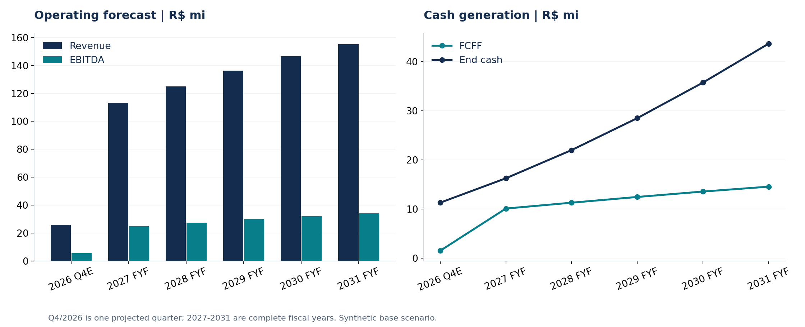

### 5. Calcular valuation e sensibilidades

O valuation usa FCFF em BRL nominal:

```text
FCFF = EBIT × (1 − imposto) + D&A − capex − ΔNWC operacional

Ke   = taxa livre de risco BRL + beta × ERP local total
WACC = We × Ke + Wd × Kd × (1 − imposto)

EV   = soma dos FCFF descontados + valor terminal descontado
```

**Juros ficam fora do FCFF.** O ERP local já contempla o componente de risco-país da hipótese ilustrativa; não se adiciona um CRP duplicado.

A convenção temporal é explícita: Q4/2026 em **t=0,25**, FY2027 em **t=1,25** e FY2031 em **t=5,25**, contados da data-base de 30/09/2026.

O terminal normaliza o reinvestimento em NWC:

```text
FCFF terminal =
    (NOPAT final + D&A final − capex final) × (1 + g)
    − g × NWC final

TV = FCFF terminal / (WACC − g)
```

O motor exige **WACC > g**, rejeita valores não finitos e não perpetua FCFF terminal negativo sem revisão. O múltiplo de saída é uma checagem separada; não é automaticamente promediado com o Gordon.

As sensibilidades incluem WACC/g, crescimento, margem terminal, capex e NWC. O valor de sinergia é separado do standalone e considera impostos, probabilidade de realização, desconto próprio e custo inicial de integração.

### 6. Estruturar preço e contraprestação

```text
Equity =
    EV operacional
    + caixa elegível
    − dívida financeira
    − debt-like verificado
    + ajuste contratual de NWC
    − despesas do vendedor
```

No exemplo inicial:

```text
EV 160 + caixa 11 − dívida 18 = equity 153
```

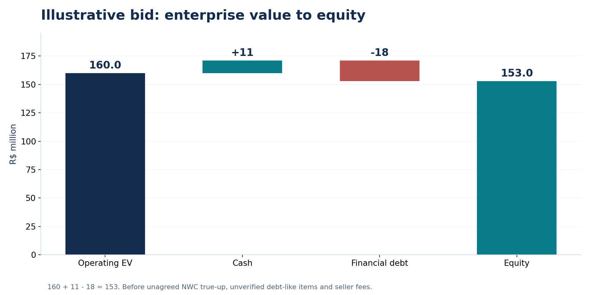

O NWC de fluxo de caixa inclui imposto a pagar. A definição contratual ilustrativa o exclui. Sem dados mensais não há peg sazonal demonstrável: o modelo mantém essa condição aberta.

`completion_accounts` e `locked_box` são alternativas. O motor rejeita empilhar um true-up de completion accounts sobre um locked-box.

A composição da contraprestação preserva as identidades:

```text
Equity all-in = upfront financiado + PV esperado do earn-out + rollover
Upfront financiado = caixa recebido agora + escrow retido
```

O máximo nominal do earn-out e seu PV esperado são valores distintos. Escrow não é somado como novo custo ao preço, e rollover não aumenta o EV operacional. Compra secundária parcial e capital primário também não são confundidos.

### 7. Simular revisão e execução

A máquina de estados permite somente os avanços previstos, com papel de revisor, ator, evidência e justificativa. A LOI depende de shortlist aprovada. O closing exige todos os gates e ausência de riscos altos pendentes.

```text
SCREENING
  → VAL_DRAFT
  → MARKETING_SIMULATED
  → IOI_SIMULATED
  → LOI_SIMULATED
  → DD_SIMULATED
  → SPA_NEGOTIATION_SIMULATED
  → CLOSED_SIMULATED
```

O pacote padrão permanece em análise e com closing bloqueado. Datas futuras da timeline são **eventos planejados**, não transações executadas.

O estado de processo alterado no dashboard fica na sessão e pode ser baixado como JSON. Ele não modifica retroativamente um valuation congelado. Os papéis do VDR demonstram uma política; não representam autenticação de usuários reais.

### 8. Congelar e exportar

O serviço reúne entradas, código, premissas, decisões e resultados em um run determinístico. A publicação local utiliza uma pasta temporária e só disponibiliza o diretório final após os controles.

Um run existente é verificado e reutilizado. Corrupção de arquivos, mudança de resultado ou adulteração do registro de métricas impede a reutilização/exportação.

---

## 📦 Dados e caso de estudo

**Alvo fictício:** NexaOps Analytics Ltda., empresa brasileira hipotética de analytics industrial e automação B2B. Os compradores Atlas Industrial Systems e Pontal Growth Capital também são fictícios. A análise buy-side e a sell-side são perspectivas alternativas da simulação.

| Arquivo | Conteúdo | Uso |
|---|---|---|
| `synthetic_income_statement.csv` | FY2023–FY2025 e 9M2025/9M2026 | Histórico e LTM |
| `synthetic_balance_sheet.csv` | Quatro datas de balanço | Caixa, dívida, NWC e conciliação |
| `synthetic_cash_flow.csv` | 2024, 2025 e 9M2026 | DFC indireta e roll-forwards |
| `synthetic_qoe_adjustments.csv` | Ajustes e referências de evidência | Ponte de earnings |
| `scenario_assumptions.csv` | Drivers dos três cenários | Forecast reproduzível |
| `risk_register.csv` | Riscos e ações requeridas | DD e condições da decisão |
| `synthetic_deal_events.csv` | Timeline planejada | Workflow ilustrativo |

As fixtures ficam em [examples/](examples/) e têm cópias idênticas no pacote para distribuição em wheel. Dados públicos brutos, arquivos de clientes e saídas geradas não são versionados.

### Unidades e datas

| Conceito | Convenção |
|---|---|
| Armazenamento do motor e SQLite | BRL em unidades originais |
| Valores monetários das fixtures | BRL milhões, com campo explícito |
| Apresentação financeira | R$ mi |
| Taxas | Frações: `0.12` representa 12% |
| Data-base do caso | 2026-09-30 |
| Informação financeira sintética disponível | Cutoff sintético da data-base |
| Execução/geração do relatório | Timestamp separado, sem mudar o valuation date |
| Tolerância contábil do motor | 0,001 BRL |
| Cenários | Hipóteses analíticas, sem probabilidades de mercado atribuídas |

### Fontes públicas opcionais

O conector CVM baixa snapshots somente quando o comando é solicitado. O parse requer membro do ZIP, CNPJ, escopo CON/IND, versão e data de publicação explícitos. Não infere EBITDA, dívida ou preço de ações a partir de campos incompletos.

Trading comps só publica mediana com **três nomes distintos, completos e utilizáveis**. Dados sem cotação, denominador positivo, datas compatíveis, política de leases e proveniência são excluídos com motivo. Transações comparáveis permanecem indisponíveis sem dados verificados.

Referências e contrato: [dados públicos](docs/PUBLIC_DATA.md) e [fontes metodológicas](docs/RESEARCH_SOURCES.md).

---

## 📊 Resultados reproduzidos

Todos os valores abaixo pertencem ao caso sintético. Os valores completos estão em [model_reference.json](docs/evidence/model_reference.json).

### Histórico e preço

| Métrica | R$ mi |
|---|---:|
| Receita líquida FY2025 | 88,000 |
| EBITDA FY2025 reportado | 19,000 |
| Lucro líquido FY2025 | 8,580 |
| Receita LTM setembro/2026 | 99,000 |
| EBITDA LTM setembro/2026 | 21,600 |
| EBIT LTM setembro/2026 | 17,800 |
| Lucro líquido LTM setembro/2026 | 9,966 |
| Dívida financeira em 30/09/2026 | 18,000 |
| Caixa em 30/09/2026 | 11,000 |
| Dívida financeira líquida | 7,000 |
| NWC operacional / contratual ilustrativo | 8,000 / 10,000 |
| Receita FY2026E | 101,000 |
| Equity de um bid EV de 160, antes do true-up | 153,000 |

### Valuation standalone

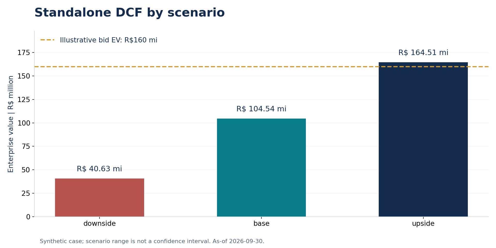

| Cenário | Crescimento inicial 2027 | Margem EBITDA terminal | Capex/receita | NWC/receita | DCF EV, R$ mi |
|---|---:|---:|---:|---:|---:|
| Downside | 5% | 17% | 8% | 11% | 40,63 |
| Base | 12% | 22% | 6% | 9% | 104,54 |
| Upside | 18% | 25% | 5% | 7% | 164,51 |

Premissas ilustrativas compartilhadas: **WACC 15,316%**, imposto simplificado 34% e crescimento terminal 4%. Essas taxas não são cotações de mercado nem conclusões tributárias sobre uma empresa real.

O cenário base fica abaixo do bid EV de R$160 mi. A regra analítica do caso retorna:

| Condição | Sinal analítico |
|---|---|
| EV standalone abaixo de 80% do bid | `WALK_AWAY` |
| EV entre 80% do bid e o próprio bid | `RENEGOTIATE` |
| EV igual ou acima do bid | `PROCEED_CONDITIONAL` |

A regra não substitui um comitê e não remove pendências de DD. A diferença de preço e o resultado desfavorável do cenário base permanecem visíveis.

---

## 🧪 Verificação e validação

| Camada | O que foi verificado | Resultado registrado |
|---|---|---|
| Testes automatizados | Finanças, dados, workflow, exportação, pesquisa e interface | **69 passed**, Python 3.10 |
| Análise estática | Código, testes e scripts | Ruff aprovado |
| Fórmulas de workbook | Referências, aritmética, MAX/MIN e caches | **518 por cenário** |
| Excel nativo | Recálculo de cópias temporárias e comparação com o motor | **1.554 fórmulas verificadas** |
| PowerPoint nativo | Abertura, renderização e altura dos textos | **16 + 10 slides**, sem overflow detectado |
| PDFs | Texto, páginas, anonimato do teaser e renderização | IC 4; DD 6; valuation 4; closing 3; teaser 1 |
| Dashboard | Todos os cenários e onze áreas | Streamlit AppTest e inspeção em navegador |
| Integridade | Arquivos, run e registro de métricas adulterados | Rejeição esperada testada |
| Distribuição | Wheel e layout isolado com fixtures empacotadas | Modelo offline reproduzido |
| CI remoto | Mesmo fluxo em Linux/Windows | Consultar execução atual em Actions |

### Casos adversos exercitados

- campo financeiro obrigatório ausente;
- conta duplicada, entidade incorreta e escopo incompatível;
- publicação futura em relação ao cutoff;
- erro de sinal e unidade/locale ambíguo;
- pedido de LTM para saldo de balanço;
- QoE sem evidência/revisor ou em período diferente;
- WACC menor ou igual a g e entradas NaN;
- cash flow negativo sem financiamento;
- ausência de cotação ou denominador válido nos comps;
- true-up indevido em locked-box;
- earn-out fora dos limites ou contraprestação inconsistente;
- distribuição de material sem revisão;
- salto de etapas e LOI sem shortlist;
- closing com riscos altos ou aprovações faltantes;
- corrupção de artefato e adulteração de métrica.

O avaliador de fórmulas cobre o subconjunto gerado pelo projeto. Não é um interpretador universal de Excel. O recálculo nativo foi executado separadamente e não é inferido apenas da existência de fórmulas salvas.

Evidências e comandos: [VALIDATION.md](docs/VALIDATION.md).

---

## 🛠️ Tecnologias

| Camada | Tecnologia | Papel |
|---|---|---|
| Linguagem | Python **3.10** | Runtime obrigatório |
| Modelagem | Biblioteca padrão, dataclasses e float64 | Motor financeiro e contratos |
| Entrada | CSV e Decimal na conversão de escala | Valores e parsing explícitos |
| Persistência | SQLite / JSON / SHA256 | Warehouse local, resultados e integridade |
| Análise tabular | pandas | Visualização e tabelas |
| Dashboard | Streamlit / Plotly | Interface, sensibilidades e waterfalls |
| Excel | XlsxWriter / openpyxl | Geração, caches e verificação |
| Relatórios | ReportLab / PyMuPDF | PDF, extração e renderização |
| Apresentações | python-pptx | Slides e gráficos nativos editáveis |
| Qualidade | pytest / Ruff | Regressão e análise estática |
| CI | GitHub Actions | Matriz Linux/Windows em Python 3.10 |
| Empacotamento | setuptools / wheel / pyproject.toml | Distribuição do pacote e fixtures |
| Documentação visual | Matplotlib / Pillow | Figuras derivadas do motor |
| Verificação Office opcional | Excel / PowerPoint / pywin32 | Recálculo e renderização nativos |

A demo não depende de Docker, Excel, PowerPoint, GPU, credenciais ou um serviço de IA. O Office é necessário apenas para repetir a verificação nativa e suas capturas; os arquivos são gerados pelas bibliotecas Python.

## 🚀 Execução rápida

### Pré-requisito

Tenha o **Python 3.10** instalado. No Windows, confirme:

```powershell
py -3.10 --version
```

### Clonar e instalar

```powershell
git clone https://github.com/Yuri-Fernando/M-A-Investment-Banking.git
cd M-A-Investment-Banking

# Instale apenas se necessário no seu ambiente Python 3.10.
py -3.10 -m pip install -r requirements-lock.txt
py -3.10 -m pip install --no-deps -e .
```

Não é necessário criar outra venv para utilizar um Python 3.10 já configurado. O arquivo `requirements-lock.txt` fixa as **dependências diretas testadas**; não é um lock transitivo com hashes.

### Gerar o pacote completo

```powershell
py -3.10 -m ma_deallab.cli demo
```

O comando carrega as fixtures, valida as identidades, modela os três cenários, verifica as fórmulas e gera um diretório em `outputs/<run_id>/`.

Sem instalação editável, é possível executar a partir do checkout:

```powershell
$env:PYTHONPATH = 'src'
py -3.10 -m ma_deallab.cli demo
```

### Iniciar o dashboard

```powershell
py -3.10 -m streamlit run src/ma_deallab/ui/app.py
```

Abra o endereço local indicado pelo Streamlit, normalmente `http://localhost:8501`. A configuração do repositório usa loopback e desabilita coleta de estatísticas de uso.

Atalhos para Windows:

```powershell
.\run_demo.ps1
.\run_dashboard.ps1
```

Em Linux, utilize um executável `python3.10` no lugar de `py -3.10`. O runtime suportado continua sendo 3.10.

### Validar

```powershell
$env:PYTHONPATH = 'src'
$env:PYTEST_DISABLE_PLUGIN_AUTOLOAD = '1'

py -3.10 -m pytest -q
py -3.10 -m ruff check src tests scripts
```

A variável de pytest evita carregar plugins globais alheios ao projeto. Não pula os testes da aplicação.

## 🖥️ Áreas do dashboard

| Área | O que apresenta |
|---|---|
| Visão geral | KPIs, cenários, preço proposto e decisão condicional |
| Histórico e checagens | DRE/BP/DFC, LTM e conciliações |
| QoE e NWC | Propostas de ajuste, evidências e definições de NWC |
| Projeções | Q4, anos completos, demonstrativos e caixa |
| Valuation | WACC, DCF, matriz WACC/g, stress e sinergia separada |
| Comparáveis | Estado dos dados, inclusões/exclusões e ausência de dados verificados |
| Buy-side e Sell-side | Scoring, ofertas fictícias, timeline e avanço de etapas |
| Diligência e data room | Riscos e política demonstrativa de papéis |
| Estrutura da transação | Ponte de preço, earn-out, escrow e termos |
| Relatórios e evidências | Geração do pacote, download e busca no registro |
| Pesquisa opcional | Monte Carlo ilustrativo e limites dos dados |

Os controles de premissas acompanham o cenário selecionado. Valores inválidos exibem erro e impedem o cálculo/exportação.

## ⌨️ CLI e customização

| Comando | Finalidade |
|---|---|
| `validate` | Conferir fixtures e identidades contábeis |
| `model` | Modelar e imprimir identificador/valores dos cenários |
| `demo` | Executar todo o fluxo offline e gerar o pacote |
| `export` | Gerar o pacote com inputs e decisões opcionais |
| `verify <directory>` | Conferir os checksums dos arquivos congelados |
| `fetch-cvm <dfp\|itr> <year>` | Download explícito de snapshot oficial |
| `inspect-cvm <zip>` | Parse de membro/companhia/escopo/versão definidos |

```powershell
py -3.10 -m ma_deallab.cli --help
py -3.10 -m ma_deallab.cli validate
py -3.10 -m ma_deallab.cli model
py -3.10 -m ma_deallab.cli verify outputs/<run_id>
```

### Premissas por cenário

Crie um JSON local com overrides. Taxas usam frações; valores monetários usam BRL:

```json
{
  "base": {
    "growth": 0.10,
    "terminal_margin": 0.20,
    "q4_revenue": 26000000,
    "terminal_g": 0.04
  }
}
```

```powershell
py -3.10 -m ma_deallab.cli export --assumptions my_assumptions.json
```

Isso gera um novo run, sem sobrescrever o anterior. As premissas completas e os limites de cada campo estão em [contracts.py](src/ma_deallab/contracts.py) e [MODEL_POLICY.md](docs/MODEL_POLICY.md).

### Aceite explícito de QoE

```json
{
  "Q01": {"reviewer": "demo-reviewer", "evidence_id": "DEMO_Q01_INVOICE"},
  "Q02": {"reviewer": "demo-reviewer", "evidence_id": "DEMO_Q02_COMP_BENCH"}
}
```

```powershell
py -3.10 -m ma_deallab.cli export --qoe-decisions decisions.json
```

A identificação é parte da simulação, não uma autenticação profissional. O aceite precisa coincidir com a evidência e com o período da proposta.

### Peers completos

`--peers peers.json` aceita dados externos completos, em BRL, com datas e proveniência. O contrato e suas exclusões estão em [PUBLIC_DATA.md](docs/PUBLIC_DATA.md). Não é uma autorização para preencher ausências com zero.

## 🧩 Uso como biblioteca

```python
from pathlib import Path

from ma_deallab.services import build_run
from ma_deallab.export import export_run

run = build_run()
base = run["scenarios"]["base"]

print(run["ltm"]["ebitda"])       # BRL: 21_600_000
print(base["valuation"]["ev"])    # BRL, não milhões
print(base["decision"])           # WALK_AWAY no caso padrão

destination = export_run(run, Path("outputs"))
print(destination)
```

Revisão dos principais contratos: [API_REFERENCE.md](docs/API_REFERENCE.md). Não há uma API HTTP publicada: o CLI e o Streamlit utilizam o serviço Python diretamente.

---

## 📁 Saídas geradas

```text
outputs/<run_id>/
├── manifest.json                  fontes, versão, status e checksums
├── run.json                       premissas e resultados completos
├── metrics_registry.json          valor, unidade, fórmula e linhagem
├── warehouse.sqlite               fatos e forecasts em BRL
├── dashboard.html                 visão offline com Plotly embutido
├── snapshots/                     os sete CSVs usados na execução
├── workbooks/
│   ├── ma_model_downside.xlsx
│   ├── ma_model_base.xlsx
│   ├── ma_model_upside.xlsx
│   ├── formulas_<scenario>.json
│   └── parity_audit.json
├── reports/
│   ├── ic.pdf / ic.md
│   ├── dd.pdf / dd.md
│   ├── valuation.pdf / valuation.md
│   ├── closing.pdf / closing.md
│   ├── anonymous_teaser.pdf
│   ├── loi_economics.md
│   ├── spa_economic_checklist.md
│   ├── buyer_bid_comparison.md
│   └── transaction_terms.json
├── presentations/
│   ├── cim.pptx                    16 slides
│   └── management.pptx             10 slides
└── vdr/                           documentos e índice sintéticos
```

O HTML pode ser aberto offline: o runtime Plotly é incluído no arquivo, sem depender de CDN. SQLite pode ser consultado com qualquer cliente compatível; a tabela `financial_facts` registra período, conta, BRL, hash de origem e classificação.

### Workbook de 33 abas

```text
00_Cover                 11_QoE                  22_WACC
01_Control               12_NWC_NetDebt          23_DCF
02_Sources               13_Assumptions          24_Peer_Comps
03_Raw_Income            14_Revenue_Drivers      25_Transaction_Comps
04_Raw_Balance           15_Operating_Model      26_Synergies
05_Raw_CashFlow          16_Capex_DA              27_Deal_Bridge
06_Account_Map           17_Debt_Interest         28_Earnout_Escrow
07_Historical_IS         18_Tax                  29_Sensitivities
08_Historical_BS         19_Forecast_IS           30_Outputs
09_Historical_CF         20_Forecast_BS           31_Checks
10_LTM                   21_Forecast_CF          32_Data_Dictionary
```

Cada arquivo corresponde a um cenário congelado. As fórmulas principais são editáveis; sensibilidades e algumas tabelas auxiliares são snapshots do motor. Após editar premissas, regenere o pacote para manter todos os relatórios consistentes. Não há um seletor de Excel que finja atualizar arquivos já congelados.

### Rascunhos e anonimato

Todos os materiais são `DRAFT_REVIEW_REQUIRED`. A geração não autoriza distribuição. O teaser omite os nomes do alvo e dos compradores; os testes verificam essa condição.

---

## 🐳 Docker

O Dockerfile usa Python 3.10 e foi incluído como opção de distribuição:

```powershell
docker build -t ma-deallab .
docker run --rm -p 127.0.0.1:8501:8501 ma-deallab
```

**Limite de evidência:** a configuração está presente; build e execução Docker não fazem parte da validação local registrada. A demonstração principal é o CLI/Streamlit diretamente no Python 3.10.

## 🖼️ Reproduzir as imagens e a verificação nativa

Figuras e capa são derivadas do motor; screenshots são capturas reais da aplicação:

```powershell
py -3.10 -m pip install -r requirements-docs.txt
py -3.10 scripts/build_readme_assets.py
```

Em Windows com Office instalado e dependências opcionais disponíveis:

```powershell
py -3.10 scripts/verify_office.py outputs/<run_id>
py -3.10 scripts/render_pdf_previews.py outputs/<run_id>
py -3.10 scripts/capture_readme_office.py outputs/<run_id> --native-render-dir outputs/validation/<run_id>/rendered
```

O verificador recalcula cópias temporárias das planilhas e abre apenas as apresentações geradas. As evidências ficam fora do diretório imutável do run. Documentação e Office são extras opcionais; não são requisitos para rodar a demo.

## 🗂️ Estrutura do repositório

```text
.
├── .github/workflows/ci.yml
├── .streamlit/config.toml
├── docs/
│   ├── assets/                    imagens técnicas e screenshots selecionados
│   ├── evidence/                  evidências portáveis, sem arquivos pessoais
│   ├── ARCHITECTURE.md
│   ├── API_REFERENCE.md
│   ├── MODEL_POLICY.md
│   ├── PUBLIC_DATA.md
│   ├── VALIDATION.md
│   └── RUNBOOK.md
├── examples/                      fixtures sintéticas canônicas
├── scripts/                       verificação, renderização e documentação
├── src/ma_deallab/                 motor e interfaces
├── templates/                     estruturas de materiais financeiros
├── tests/                         suíte offline
├── .gitignore
├── CHANGELOG.md
├── Dockerfile
├── pyproject.toml
├── requirements-lock.txt
├── requirements-docs.txt
├── run_demo.ps1
└── run_dashboard.ps1
```

## 🚧 Limitações e escopo

| Limitação | Implicação prática |
|---|---|
| Caso integralmente sintético | Nenhum resultado é evidência de uma transação ou companhia real |
| WACC e impostos ilustrativos | Não substituem pesquisa contemporânea ou análise tributária |
| Dívida fixa e tributação simplificada | Sem plano de financiamento, imposto diferido ou prejuízo fiscal modelado |
| Sem NWC mensal | Peg normalizado e sazonalidade não são inferidos |
| Sem dados granulares de clientes | Não há churn/coortes derivados de dados agregados |
| Sem comparáveis verificados carregados | Não existe mediana de bolsa ou de transações publicada por padrão |
| Importador CVM | Parse local testado; download real não faz parte da evidência registrada |
| Papéis simulados | Não constituem autenticação, autorização ou VDR pronto para dados reais |
| Log de processo por sessão | Não equivale a auditoria persistente de cada acesso/documento |
| Monte Carlo não calibrado | É sensibilidade de modelo, não probabilidade empírica de investimento |
| Sem LLM configurado | Busca de evidências não é apresentada como geração de análise por IA |
| Sem implantação produtiva | Hosting, segredos, observabilidade e controles reais exigem trabalho próprio |
| Dependências diretas fixadas | Não há promessa de lock transitivo ou igualdade binária de PDFs entre plataformas |

Os bytes de PDF/PPTX podem variar por timestamp, fontes e plataforma. A reprodutibilidade prometida é a dos **inputs, premissas, código e resultados numéricos** do run.

## 🚀 Aplicações

- Laboratório local de modelagem e validação financeira.
- Estudo de estruturas de preço em transações hipotéticas.
- Comparação de premissas e cenários em um caso reproduzível.
- Geração consistente de materiais analíticos.
- Pesquisa de controles de dados e rastreabilidade em modelos financeiros.
- Base técnica para evoluções que recebam dados autorizados e controles adequados.

## 🔭 Visão de longo prazo

A evolução parte do motor financeiro existente e de dados verificáveis:

```text
DealLab Core
   ├── Dados públicos point-in-time e revisão contábil por emissor
   ├── NWC mensal e políticas contratuais mais completas
   ├── Receitas por cliente e análise de retenção/coortes
   ├── Revisão persistente e auditoria de acesso ao VDR
   ├── Calibração e validação de distribuições de stress
   └── Segurança, operação e implantação com escopo próprio
```

Integração disponível e implantação validada permanecem estados diferentes. Uma interface com bom acabamento não transforma o caso em sistema pronto para dados confidenciais reais.

## 🗺️ Roadmap

- [x] Ingestão e conciliação das fixtures.
- [x] Histórico, LTM e QoE com evidência.
- [x] Forecast integrado e cenários.
- [x] DCF datado, terminal normalizado e sensibilidades.
- [x] EV/equity e mecanismos de contraprestação.
- [x] Workflow e materiais simulados.
- [x] Dashboard, Excel, PDF, PPTX, HTML e SQLite.
- [x] Testes, verificação de fórmulas e renderização nativa.
- [x] Documentação visual e CI Linux/Windows.
- [ ] Completar snapshots públicos históricos e política de leases por emissor.
- [ ] Integrar NWC mensal e dados de clientes com proveniência.
- [ ] Persistir revisão e auditoria de acesso com autenticação real.
- [ ] Calibrar incerteza e ampliar modelos de financiamento/tributação.
- [ ] Validar runtime Docker e implantação com requisitos próprios.

## 📚 Documentação

| Documento | Conteúdo |
|---|---|
| [ARCHITECTURE.md](docs/ARCHITECTURE.md) | Dependências, contratos, persistência e decisões |
| [MODEL_POLICY.md](docs/MODEL_POLICY.md) | Convenções e fórmulas implementadas |
| [DEAL_CASE.md](docs/DEAL_CASE.md) | Caso sintético e demonstrações de referência |
| [PUBLIC_DATA.md](docs/PUBLIC_DATA.md) | CVM, datas e contrato de comparáveis |
| [API_REFERENCE.md](docs/API_REFERENCE.md) | Funções públicas, inputs e unidades |
| [VALIDATION.md](docs/VALIDATION.md) | Testes, evidência e limites do que foi verificado |
| [RUNBOOK.md](docs/RUNBOOK.md) | Execução, customização e solução de erros |
| [DEAL_PROCESS.md](docs/DEAL_PROCESS.md) | Etapas e controles da simulação |
| [DUE_DILIGENCE.md](docs/DUE_DILIGENCE.md) | Earnings, NWC, dívida e riscos |
| [DOCUMENTS_AND_PRESENTATIONS.md](docs/DOCUMENTS_AND_PRESENTATIONS.md) | Contratos dos materiais gerados |
| [RESEARCH_SOURCES.md](docs/RESEARCH_SOURCES.md) | Referências metodológicas e fontes oficiais |
| [CHANGELOG.md](CHANGELOG.md) | Histórico técnico da versão |
| [templates/](templates/) | Estruturas de documentos para revisão |
| [docs/evidence/](docs/evidence/) | Valores e validações reproduzíveis |

## 🧹 Política de versionamento

O repositório contém código, testes, configurações, fixtures sintéticas, templates e documentação técnica selecionada.

O `.gitignore` exclui brainstorms, adendos, ideias, arquivos de preparação pessoal, ZIPs, caches, ambientes locais, credenciais, dados públicos brutos e pacotes gerados em `outputs/`. As imagens e evidências pequenas em `docs/` são seleções deliberadas para documentar o comportamento real.

## 📄 Licença

Este repositório ainda não possui uma licença de redistribuição definida. As referências públicas e os dados eventualmente importados mantêm suas condições próprias de uso. Nenhum dataset proprietário ou material de cliente integra a demonstração.
